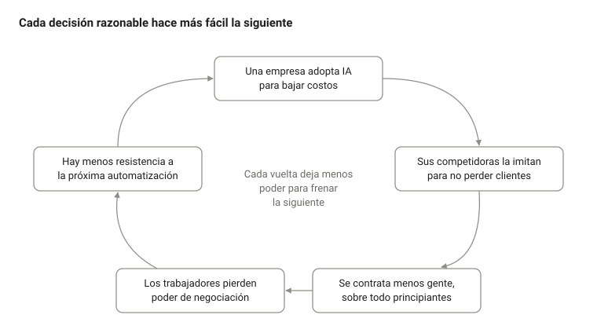

<p align="center">
  
</p>

# El desplazamiento silencioso

*Por qué la inteligencia artificial no necesita atacarnos para dejarnos afuera*

Un ensayo de Bruno Loiacono · 2026 · Forma parte de [Ideas](https://github.com/LoiaconoBruno/ideas)

**[Leer en la web](https://loiaconobruno.github.io/el-desplazamiento-silencioso/)** · **[Descargar EPUB](https://loiaconobruno.github.io/el-desplazamiento-silencioso/el-desplazamiento-silencioso.epub)** · [Leer acá en GitHub](capitulos/portada.md)

Durante décadas imaginamos el peligro de la inteligencia artificial como un robot armado. Este libro sostiene otra cosa: **nadie nos ataca; cedemos.** El desplazamiento que ya empezó no tiene villano. Es la suma de millones de decisiones razonables de empresas, trabajadores, clientes y gobiernos que, juntas, producen un resultado que nadie eligió: un mundo donde las personas hacen cada vez menos falta.



## Índice

| Capítulo | De qué trata |
| --- | --- |
| [Sobre este libro](capitulos/portada.md) | Presentación, cómo se escribió y licencia |
| [Introducción. No habrá Terminator](capitulos/00-introduccion.md) | La imagen equivocada del peligro y la tesis del libro |
| [1. El villano que no existe](capitulos/01-el-villano-que-no-existe.md) | Por qué la metáfora del ataque es cómoda y a quién absuelve |
| [2. Mil decisiones razonables](capitulos/02-mil-decisiones-razonables.md) | Cómo decisiones sensatas suman un resultado que nadie eligió |
| [3. La escalera sin primer escalón](capitulos/03-la-escalera-sin-primer-escalon.md) | El trabajo de principiante, lo primero que se cierra |
| [4. Cuando ya no hacemos falta](capitulos/04-cuando-ya-no-hacemos-falta.md) | Qué pasa con el poder de negociar cuando dejamos de ser necesarios |
| [5. La comodidad como anestesia](capitulos/05-la-comodidad-como-anestesia.md) | Delegar pensar, elegir y recordar |
| [6. Voces sintéticas](capitulos/06-voces-sinteticas.md) | Cultura, contenido y vínculos cuando la conversación se llena de máquinas |
| [7. Decisiones sin decisores](capitulos/07-decisiones-sin-decisores.md) | Estados y empresas que deciden con sistemas, y quién rinde cuentas |
| [8. Desde el sur](capitulos/08-desde-el-sur.md) | Argentina y América Latina frente al desplazamiento |
| [9. Lo que todavía depende de nosotros](capitulos/09-lo-que-todavia-depende-de-nosotros.md) | Respuestas individuales, colectivas y políticas |
| [Epílogo. Carta a quien lea esto en 2036](capitulos/10-epilogo.md) | Una carta al lector del futuro |
| [Notas y fuentes](capitulos/11-notas-y-fuentes.md) | Las fuentes de cada capítulo |

## Cómo se escribió

Este libro se escribió con asistencia de inteligencia artificial (Claude, de Anthropic), a partir de la idea, la tesis y las decisiones editoriales del autor. Las cifras y los casos se verificaron contra las fuentes de [Notas y fuentes](capitulos/11-notas-y-fuentes.md), actualizadas a noviembre de 2026.

## Correcciones

Si encontrás un dato mal citado, una fuente rota o un error, abrí un *issue* o mandá un *pull request*.

## Compilar el libro

El repositorio genera dos formatos a partir de los mismos archivos de `capitulos/`:

- **Web**, con [mdBook](https://rust-lang.github.io/mdBook/) 0.5.4.
- **EPUB**, con [pandoc](https://pandoc.org/).

```bash
mdbook serve --open      # la web, en http://localhost:3000
bash scripts/epub.sh     # el EPUB, en book/el-desplazamiento-silencioso.epub
```

Cada cambio en la rama `main` publica la web y el EPUB en GitHub Pages con el workflow [`publicar.yml`](.github/workflows/publicar.yml).

## Licencia

El texto se publica bajo [Creative Commons Atribución-CompartirIgual 4.0 Internacional (CC BY-SA 4.0)](LICENSE). Podés copiarlo, adaptarlo y redistribuirlo, incluso con fines comerciales, siempre que menciones al autor y compartas tu versión bajo la misma licencia.
